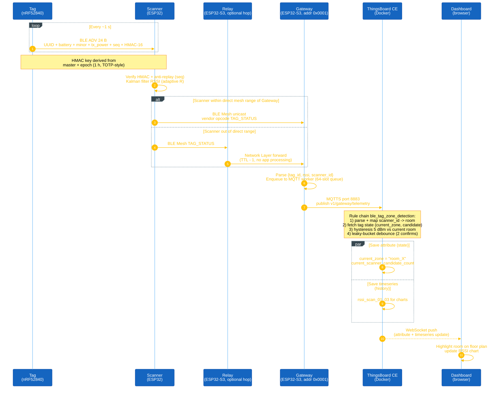

# Architecture

BLE Mesh Tracking is a room-level indoor tracking system. It uses BLE Mesh for the radio, ESP32 and ESP32-S3 for the nodes, and ThingsBoard CE as the server.

## Data flow

The [root README](../README.md#iii-data-flow) shows the high-level sequence as an image (boot and provisioning, tag beacon, mesh uplink, zone decision, self-healing and OTA). The diagram below is the step-by-step data path for one tag report: Tag ADV → HMAC verify → mesh → MQTTS → rule chain → dashboard.

<strong><em>Figure 1:</em></strong> Tag report data path

## Rules

- The gateway only forwards data. It does not pick a room. Room logic runs in the ThingsBoard rule chain.
- The rule chain uses 5 dBm hysteresis, leaky-bucket debounce, and a `MAC -> room` map. You edit the map on the server, not in firmware.
- Every scanner runs the same firmware. Each one uses its own Bluetooth MAC as its ID.
- The Tag beacon key rotates hourly (TOTP-style derivation from the master key). The OTA-beacon key rotates every 24 h and is pushed to scanners over mesh - these are two independent keys.

## Hardware

| Node | Board | Notes |
|---|---|---|
| Tag | ESP32-S3 | Battery-powered beacon. Coin-cell variant on nRF52840 available - see [apps/beacon_nrf52840/README.md](../apps/beacon_nrf52840/README.md) (XIAO or ProMicro). |
| Scanner x3 | ESP32 | All scanners use the same board so they share one OTA build. |
| Relay | ESP32-S3 | Sits between far scanners and the gateway. |
| Gateway | ESP32-S3 | Runs WiFi and BLE at the same time. 16 MB flash. |

## Physical layout

BLE range in a typical indoor environment (drywall + concrete, no line-of-sight) is 5 - 10 m usable, sharply reduced by walls at 2.4 GHz. Placement matters more than any tuning:

- **One scanner per room you want to distinguish.** The rule chain maps `scanner_id -> room`, so a room without its own scanner is invisible. Put the scanner near the middle of the room, above head height (2 - 2.5 m), away from big metal (fridge, filing cabinet).
- **Gateway sits with the router / server.** It needs WiFi to the LAN running ThingsBoard, so put it near the AP. It does not need to be near any scanner; the mesh handles that.
- **Relay only if a scanner cannot hear the gateway directly.** In a 3-room 55 m² apartment layout, one relay in the hallway between the two farthest scanners and the gateway is enough. Overpopulating with relays does not help and adds mesh traffic.
- **Tags live on the person or asset being tracked.** No fixed placement - the whole point is that they move.
- **Do not stack scanners in the same room.** Two scanners with a clear line-of-sight to the same tag will fight for "best signal" and cause zone flap even with hysteresis on.

For a wearable coin-cell tag, use the nRF52840 Beacon variant - [apps/beacon_nrf52840/README.md](../apps/beacon_nrf52840/README.md). The ESP32-S3 tag is fine for prototyping but drains faster than a coin cell can sustain.

## Where the layers live in the repo

| Layer | Where |
|---|---|
| Tag firmware | `apps/tag` (ESP-IDF) or `apps/beacon_nrf52840` (Zephyr, XIAO or ProMicro) |
| Scanner firmware | `apps/scanner` (ESP-IDF) |
| Relay firmware | `apps/relay` (ESP-IDF) |
| Gateway firmware | `apps/gateway` (ESP-IDF) |
| Shared code | `components/` - `bmt_protocol` (wire format), `bmt_https_ota` (HTTPS OTA core), `bmt_ota` + `bmt_mesh_node` (scanner + relay), `bmt_factory_reset` |
| Server stack | `thingsboard/docker-compose.yml` (ThingsBoard + PostgreSQL + nginx OTA) |
| Rule chain + dashboard | `thingsboard/rulechain/*.json`, `thingsboard/dashboard/*.json` |
| TLS material | `thingsboard/tls/` (self-signed CA, server cert; regen with `gen_certs.sh`) |
